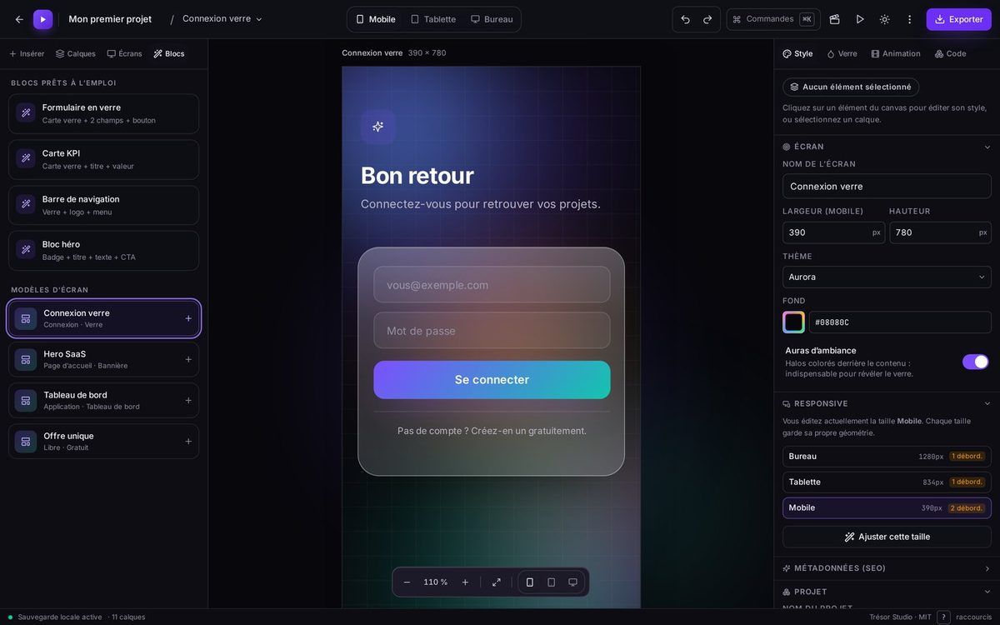
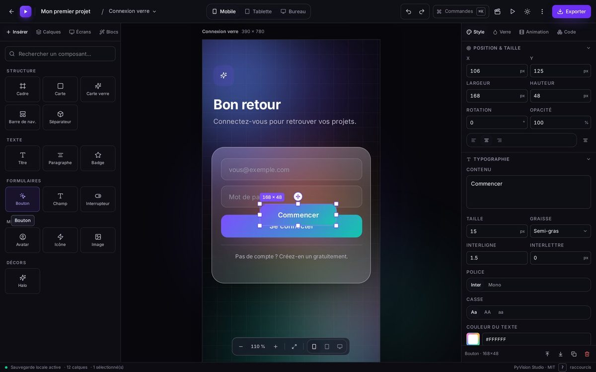
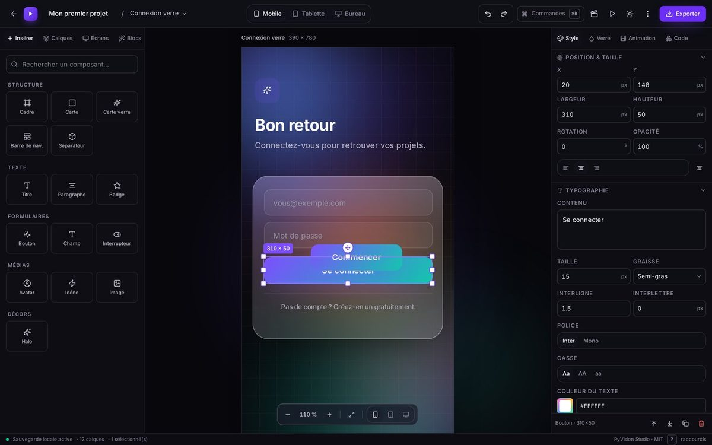
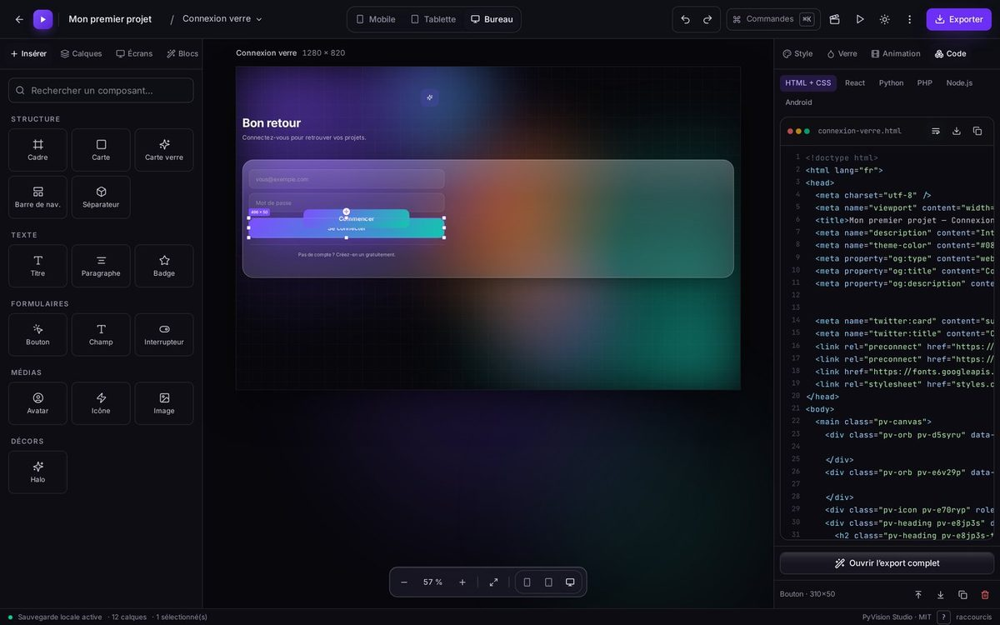
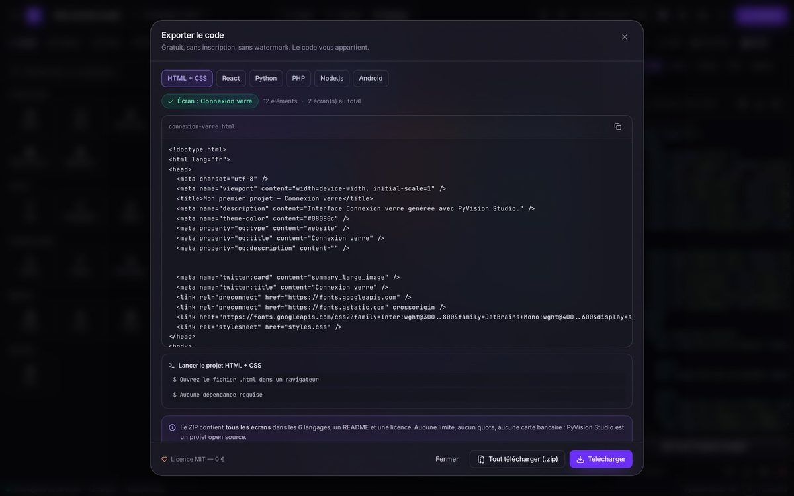
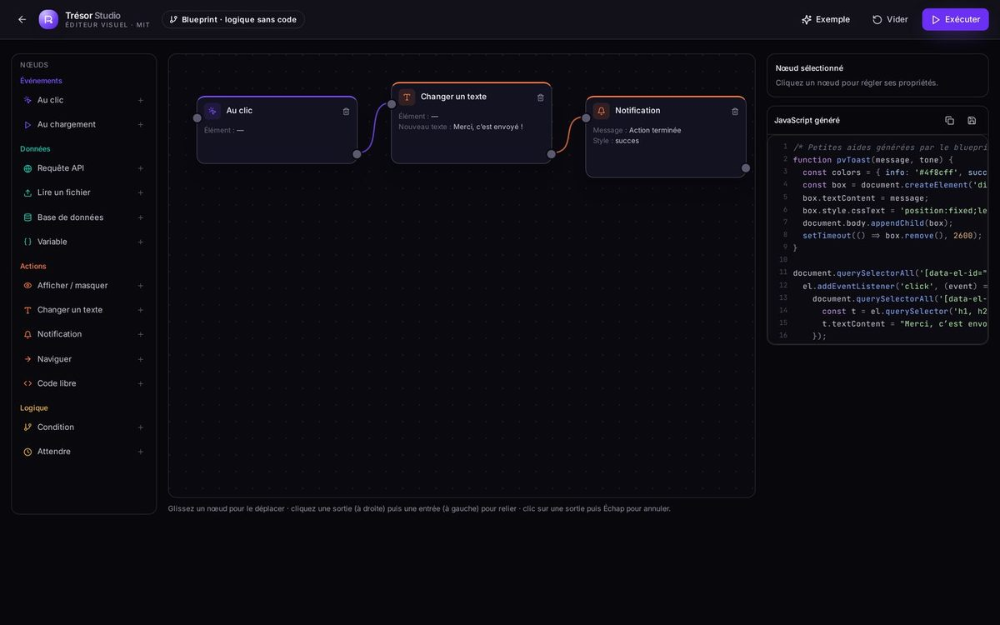
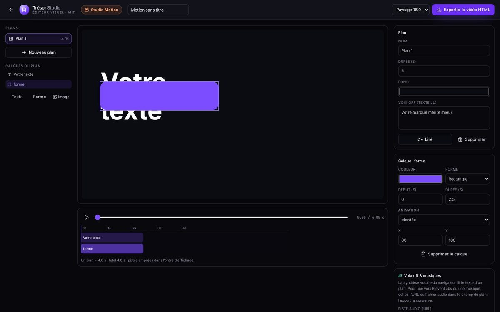

# Tresor_Studio-
Visual UI editor, motion design and node-based logic. Design by hand, export real code (HTML, React, Python, PHP, Node.js, Android) as one runnable file. Browser-only, MIT.

# Trésor Studio

**Design your interface. Export the code.**

A visual UI editor, a motion design workbench and a node-based logic editor in a single web app. Compose with the mouse, animate, describe behaviour without writing code — then export real code: HTML, React, Python, PHP, Node.js or Android.

Everything runs in the browser. No account, no server required, no data leaves your machine.

<p>
  <a href="LICENSE"></a>
  
  
  
  
  
</p>



---

## Contents

- [What it does](#what-it-does)
- [Screenshots](#screenshots)
- [Quick start](#quick-start)
- [Six export targets](#six-export-targets)
- [Responsive](#responsive)
- [Motion design](#motion-design)
- [Logic without code](#logic-without-code)
- [Code runner](#code-runner)
- [AI, MCP and REST API](#ai-mcp-and-rest-api)
- [Repository layout](#repository-layout)
- [Tests](#tests)
- [Keyboard shortcuts](#keyboard-shortcuts)
- [Customisation](#customisation)
- [Author](#author)
- [License](#license)

---

## What it does

### Interface editor

- **51 components**: structure (frame, card, glass card, navbar, divider), text, forms, data, navigation, media, feedback, vectors (rectangle, ellipse, triangle, polygon, star, line, arrow) and **7 ready-made blocks**.
- Canvas with drag & drop, multi-select, snapping, alignment guides, eight resize handles, rotation, in-place text editing, zoom and fit-to-screen.
- **Layered hierarchy**: hide, lock, reorder, drop into a container. A child never escapes its frame.
- Configurable glass (tint, veil, blur 0–60 px, saturation, border, highlight) with five deliberately restrained presets — glass is an accent, never the subject.
- Six themes, auras, shadows, linear gradients and SEO metadata.

### Organisation

- Multiple projects, multiple screens, duplication, renaming, full export.
- Undo/redo history, ⌘K command palette, instant search.
- Automatic save in the browser (local storage): your projects stay on your machine.

---

## Screenshots

| | |
| --- | --- |
|  |  |
| Canvas, guides and layers | Inspector: style, glass, responsive, SEO |
|  |  |
| Generated code, highlighted and copyable | Export and instant run |
|  |  |
| Node-based logic | Motion Studio: scenes, layers, timeline |

---

## Quick start

```bash
git clone https://github.com/tresormika/Tresor_Studio.git
cd Tresor_Studio
npm install
npm run dev          # http://localhost:5173
```

REST API and MCP server:

```bash
npm run build:server # shared bundle (required by the API, MCP and tests)
npm run server       # REST API on http://localhost:8787
npm run mcp          # MCP server over stdio (18 tools)
```

Production:

```bash
npm run build              # dist/ — separate files, for a static server
npm run build:standalone   # dist-standalone/index.html — ONE self-contained file
npm run build:all          # both + the server bundle
```

> `dist-standalone/index.html` embeds the CSS, the JavaScript **and the fonts**: double-click it and it runs,
> no server needed. Prefer this form when delivering a mockup.

---

## Six export targets

| Target | Content |
| --- | --- |
| **HTML + CSS** | standalone, responsive page with SEO metadata |
| **Single file** | CSS and JavaScript inlined: directly runnable |
| **React** | functional component, styles as objects |
| **Python** | CustomTkinter interface |
| **PHP** / **Node.js** | server pages ready to render |
| **Android** | Jetpack Compose screen |
| **ZIP** | every screen, every language, README and license |

The **Run** button loads the export into a sandboxed iframe at all three sizes, before any download.

```css
/* Generated snippet */
.pv-glasscard.pv-8f2a1c {
  position: absolute;
  left: 20px; top: 236px;
  width: 350px; height: 300px;
  border-radius: 28px;
  background: rgba(255, 255, 255, 0.14);
  backdrop-filter: blur(18px) saturate(170%);
  border: 1px solid rgba(255, 255, 255, 0.28);
}

@media (max-width: 639px) {
  .pv-glasscard.pv-8f2a1c { left: 16px; width: 358px; }
}
```

---

## Responsive

Three breakpoints, three independent geometries, **one composition**:

| Size | Dimensions | Media query |
| --- | --- | --- |
| Desktop | 1280 × 820 | reference |
| Tablet | 834 × 900 | `max-width: 1023px` |
| Mobile | 390 × 780 | `max-width: 639px` |

Scaling is **proportional**: blocks keep their relative position and hierarchy, near-full-width text shrinks its font size, and the navbar collapses into a compact version (nothing is cut off). Every override becomes a real `@media` rule in the exported CSS, and the inspector flags elements that overflow their frame, size by size.

---

## Motion design

- **17 layer animations**: fade, rise, zoom, bounce, rotate, breathe, slide, shake, flip, glow…
- **Multi-track timeline** with play, loop and per-track offset.
- **Motion Studio**: scenes, text / shape / image layers, 72 px-per-second timeline, per-layer inspector.
- **Voice-over** through the browser speech synthesis, or an audio track by URL (ElevenLabs, Gemini…) played at the start of the scene.
- **Export** as a self-contained HTML page that plays the montage, with audio, mobile scaling and `prefers-reduced-motion` support.

---

## Logic without code

A node-based blueprint editor that compiles to real JavaScript:

| Family | Nodes |
| --- | --- |
| Events | On click (on an element), On load |
| Data | API request, Read a file, Database, Variable |
| Actions | Show / hide, Set text, Notification, Navigate, Free script |
| Logic | Condition (`true` / `false` branches), Wait (delay) |

The generated code sits next to the graph, can be copied or downloaded, and is injected automatically into the single-file export. Nodes target elements through `data-el-id`, so the result really fires on click.

---

## Code runner

HTML + CSS + JavaScript sandbox in an isolated iframe: built-in console, live update while typing, three screen sizes, one-click import of a studio screen, download as a single file.

---

## AI, MCP and REST API

**MCP server (stdio) — 18 tools**, usable from Claude Desktop, Cursor, Zed or Continue:

```
lister_composants   lister_modeles    lister_themes     lister_glass
lister_projets      creer_projet      lister_ecrans     lire_ecran
creer_ecran         ajouter_element   adapter_responsive
exporter_code       inspecter_code    lister_widgets
exporter_fichier_unique               generer_logique
creer_montage_motion                  lister_presets_motion
```

```json
{
  "mcpServers": {
    "tresor": {
      "command": "node",
      "args": ["/absolute/path/Tresor_Studio/server/mcp.js"]
    }
  }
}
```

**REST API** on `http://localhost:8787`:

| Method | Route | Purpose |
| --- | --- | --- |
| GET | `/api/health` | Server status |
| GET | `/api/components` | Component catalogue |
| GET | `/api/widgets` | Rich components |
| GET/POST | `/api/projects` | List / create a project |
| GET/PUT/DELETE | `/api/projects/:id` | Read, replace, delete |
| POST | `/api/projects/:id/screens` | Add a screen (with template) |
| POST | `/api/projects/:id/screens/:sid/elements` | Add an element |
| GET | `/api/projects/:id/screens/:sid/export/:lang` | Generate code |
| GET | `/api/projects/:id/screens/:sid/single-file` | HTML + CSS + JS in one file |
| POST | `/api/blueprint/compile` | Nodes + edges → JavaScript |
| GET | `/api/motion/presets` | Formats and animations |
| POST | `/api/motion/export` | Montage → animated HTML page |

The studio stores no keys and calls no paid service. For generated voice or images (ElevenLabs, Gemini), the call comes from your own code, with your own key. Details: [`docs/MCP.md`](docs/MCP.md).

---

## Repository layout

```
Tresor_Studio/
├── src/
│   ├── lib/            model, generators, responsive, motion, blueprint, doc content
│   ├── components/     landing, studio (canvas, inspector, timeline, export), UI
│   ├── pages/          home, studio, projects, templates, docs, open source,
│   │                   features, AI/MCP, runner, blueprint, motion, developer
│   └── store/          studio state (projects, screens, history)
├── server/             REST API (index.js), MCP server (mcp.js), JSON storage
├── scripts/            self-contained single-file build
├── tests/run.mjs       278 checks, module by module
├── public/docs/        screenshots used by the in-app documentation
├── README.md · README.fr.md · LICENSE · CHANGELOG-2.0.md
```

Key modules:

| File | Role |
| --- | --- |
| `src/lib/elements.js` | types, icons, glass presets, style resolution |
| `src/lib/widgets.jsx` / `widget-html.js` | 51 components, in React **and** as export HTML |
| `src/lib/project.js` | project / screen / element model |
| `src/lib/responsive.js` | proportional recalculation per breakpoint |
| `src/lib/motion.js` · `motionstudio.js` | screen animations, montage projects |
| `src/lib/blueprint.js` | nodes, edges, JavaScript compilation |
| `src/lib/generator.js` | 6 export targets + single file |
| `src/lib/highlight.js` | hand-written syntax highlighter |

---

## Tests

```bash
npm test    # build:server + tests/run.mjs, writes tests/RAPPORT.md
```

**278 checks** covering: elements and styles, project model, responsive across three templates, animations, generators (6 targets × every component, JavaScript validated with `new Function`), components, blueprint and full project export.

---

## Keyboard shortcuts

| Action | Key |
| --- | --- |
| Command palette | `⌘K` / `Ctrl+K` |
| Undo / redo | `⌘Z` / `⌘⇧Z` |
| Duplicate | `⌘D` |
| Copy / paste | `⌘C` / `⌘V` |
| Delete | `Del` |
| Interactive preview | `P` |
| Zoom 100 % | `0` |
| Move by 1 px / 10 px | `Arrows` / `Shift+Arrows` |
| Shortcut help | `?` |

---

## Customisation

| What | Where |
| --- | --- |
| Product name, developer details | `src/lib/brand.js` |
| The 60 features listed on the site | `src/lib/features-content.js` |
| The in-app documentation (23 chapters) | `src/lib/docs-content.js` |
| Components | `src/lib/widgets.jsx` **and** `src/lib/widget-html.js` |
| Export languages | `src/lib/generator.js` |

Every new component must exist in two consistent versions: React for the canvas, HTML for the export.

---

## Contributing

Missing component, bug, translation, screenshot? Open an issue or a pull request. The test suite must stay green (`npm test`).

---

## Author

**Lankoandé Trésor Mikatresormika** — web and mobile developer, Ouagadougou, Burkina Faso.

- GitHub: [@tresormika](https://github.com/tresormika)
- Email: [tresormikalankoande@gmail.com](mailto:tresormikalankoande@gmail.com)

---

## License

MIT — see [`LICENSE`](LICENSE). The code you generate is entirely yours.
